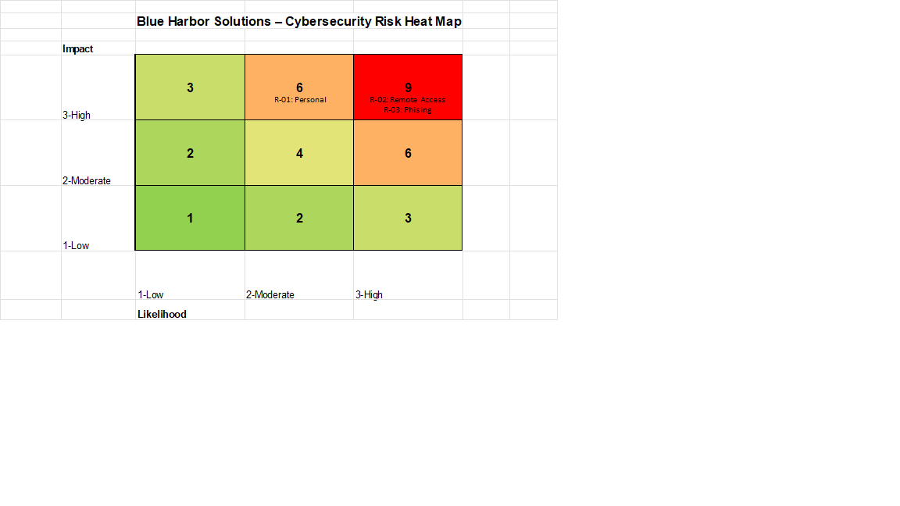

# Cybersecurity Risk Assessment & Mitigation
### Blue Harbor Solutions | GRC Portfolio Project

## Project Overview

This project demonstrates a scenario-based cybersecurity risk assessment conducted for Blue Harbor Solutions, a fictional organization transitioning to hybrid and remote work operations.

The assessment focused on identifying critical information assets, evaluating cybersecurity threats and vulnerabilities, determining risk likelihood and impact, and recommending appropriate risk treatment strategies.

This project was completed as part of graduate-level Cybersecurity Risk Management coursework at Old Dominion University.

## Assessment Objectives

- Identify critical organizational information assets.
- Evaluate cybersecurity threats and security vulnerabilities.
- Assess risk likelihood and potential business impact.
- Calculate and prioritize cybersecurity risk scores.
- Recommend appropriate risk responses and security safeguards.
- Support risk-based decision-making and organizational security improvements.

## Organizational Assets

The assessment identified three critical information assets:

1. **Financial and Employee Records:** Sensitive organizational and employee information requiring protection against unauthorized access and disclosure.
2. **Customer Database:** Cloud-based customer information that must be protected from potential data breaches.
3. **Employee Email Accounts:** Business communication systems that may expose confidential information if compromised.

## Identified Threats and Vulnerabilities

The assessment examined the following security concerns:

- **Malware and Unpatched Devices:** Outdated software and missing security updates increase exposure to malware and exploitation.
- **Phishing and Credential Theft:** Inadequate phishing-awareness training increases the likelihood of employee credential compromise.
- **Unauthorized Access:** Inconsistent multifactor authentication increases the risk of attackers accessing organizational systems using stolen credentials.

## Risk Assessment Methodology

A qualitative likelihood and impact assessment was conducted using a three-point rating scale.

Risk scores were calculated using the following formula:

**Risk Score = Likelihood × Impact**

The assessment used likelihood and impact ratings from 1 (Low) to 3 (High). Higher scores indicate greater risk and help prioritize mitigation efforts.

## Risk Assessment Results

| Identified Risk | Likelihood | Impact | Risk Score | Assessment Rating |
|---|---|---|---|---|
| Use of Personal Devices for Company Work | 2 - Moderate | 3 - High | 6 | High |
| Insecure Remote Access | 3 - High | 3 - High | 9 | High |
| Phishing and Credential Theft | 3 - High | 3 - High | 9 | High |

## Risk Heat Map

The heat map illustrates the likelihood and impact of three identified cybersecurity risks. Phishing and credential theft and insecure remote access received the highest risk scores of 9, while the use of personal devices received a score of 6.

## Risk Prioritization

Phishing and credential theft were identified as a priority risk because compromised employee credentials had already resulted in unauthorized access to organizational systems.

Insecure remote access also received a risk score of 9, indicating a high likelihood and potential impact.

The assessment recommended prioritizing compromised account remediation, strengthening authentication requirements, and improving employee security awareness.

## Risk Treatment Recommendations

| Identified Risk | Risk Response | Recommended Safeguards |
|---|---|---|
| Phishing and Credential Theft | Mitigate | Mandatory phishing-awareness training, multifactor authentication, and formal phishing reporting procedures |
| Personal Devices for Company Work | Avoid | Prohibit unmanaged personal devices and provide approved company-managed equipment |
| Insecure Remote Access | Mitigate | Company-managed VPN, multifactor authentication, endpoint protection, and regular security patching |

## Key Findings

- Phishing and credential theft represent a significant cybersecurity risk due to previously compromised employee accounts.
- Insecure remote access creates additional exposure through home and public Wi-Fi connections.
- Unmanaged personal devices increase the risk of inconsistent security configurations and missing updates.
- Strengthening authentication, endpoint security, and employee awareness can reduce organizational cybersecurity exposure.

## Skills Demonstrated

- Cybersecurity Risk Identification
- Asset Identification and Classification
- Threat and Vulnerability Analysis
- Qualitative Risk Assessment
- Likelihood and Impact Analysis
- Risk Scoring and Prioritization
- Risk Mitigation and Avoidance
- Cybersecurity Risk Documentation
- Governance, Risk, and Compliance (GRC)

## Project Deliverables

- Cybersecurity Risk Register (Excel)
- Cybersecurity Risk Assessment Report (PDF)
- Risk Assessment Heat Map (PNG)

## Disclaimer

This project is based on a fictional academic case study developed for educational purposes. Risk scores, findings, and recommendations reflect a simulated assessment and do not represent an actual cybersecurity assessment of a real organization.
